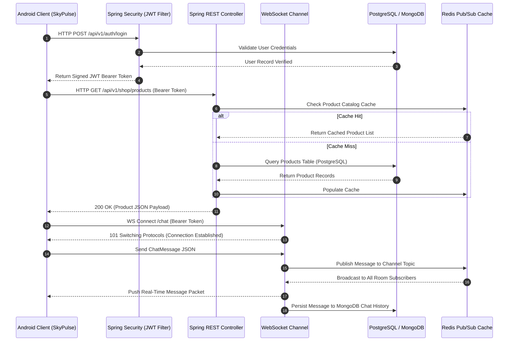

# ⚙️ SkyPulse Backend Documentation

This document provides a detailed breakdown of the backend architecture, technologies, databases, real-time protocols, and design justifications for the **SkyPulse** Spring Boot server infrastructure.

---

## 🏗️ Architecture Overview

The SkyPulse backend is built using a **polyglot persistence micro-monolith / REST API** architecture:
* **Framework**: **Spring Boot 3** with **Java 17/21**.
* **Security**: **Spring Security** with **Stateless JWT Authentication**.
* **Relational Storage**: **PostgreSQL** with **Spring Data JPA (Hibernate)** for ACID-compliant core data.
* **Document Storage**: **MongoDB** for unstructured social feeds, articles, and chat history logs.
* **In-Memory Caching & Pub/Sub**: **Redis** for product caching and live WebSocket message distribution.
* **Real-time Comms**: **Spring WebSocket & STOMP** for bi-directional live chat channels.
* **Notification System**: **JavaMailSender** for automated transactional checkout manifests.

---

## 🛠️ Backend Technology Stack & Justification

| Technology / Component | SkyPulse Use Case | Why Selected Over Counterpart  |
| :--- | :--- | :--- |
| **Java 17/21 & Spring Boot 3** | Core backend web framework providing REST APIs, dependency injection, and transaction management. | **Over Express.js / Django**: Enterprise-grade dependency injection, robust multi-threading, type safety, and rich Spring ecosystem for high-concurrency workloads. |
| **Spring Security & Stateless JWT** | Protects REST endpoints and WebSocket handshakes with JSON Web Tokens. | **Over Session Cookies**: Stateless authentication allows seamless horizontal scaling across server instances without session replication overhead. |
| **PostgreSQL & Spring Data JPA** | Primary relational database storing ACID-compliant data (User accounts, Orders, Cart items, Product catalog). | **Over MySQL / SQLite**: Superior support for complex relational joins, JSONB column indexing, strict transactional consistency, and enterprise durability. |
| **MongoDB & Spring Data MongoDB** | Document-oriented database storing unstructured community feed posts, comments, and historical chat room logs. | **Over Relational SQL for Feeds**: Schema-less document flexibility enables fast insertions and dynamic array queries for evolving social content and chat history. |
| **Redis & Redis Pub/Sub** | High-speed in-memory cache for catalog endpoints and message broker for WebSocket chat rooms. | **Over RabbitMQ / Kafka for Chat**: Ultra-fast sub-millisecond in-memory message routing with minimal setup complexity for low-latency live chat channels. |
| **Spring WebSocket & STOMP Protocol** | Bi-directional persistent socket connection for broadcasting live chat messages across room subscribers. | **Over Server-Sent Events (SSE)**: Full bi-directional client-server messaging allowing clients to both send and receive chat packets over a single connection. |
| **JavaMailSender (SMTP Integration)** | Automated email service sending order confirmation manifests and security alerts upon checkout completion. | **Over Third-Party HTTP Mail APIs**: Native Spring integration with standard SMTP servers without external vendor lock-in or recurring API costs. |
| **BCrypt Password Encoder** | Strong cryptographic hashing for user passwords prior to database storage. | **Over MD5 / SHA-256**: Key-stretching algorithm with auto-salted iterations provides built-in protection against rainbow table and brute-force attacks. |

---

## 🌐 API Endpoint Specifications

### 1. **Authentication Controller (`/api/v1/auth`)**
* `POST /login` — Validates credentials and returns JWT Bearer token & user profile.
* `POST /register` — Creates new user account with BCrypt encrypted password.
* `POST /change-password` — Validates current password and updates to new credentials.

### 2. **Cosmic Feed Controller (`/api/v1/feed`)**
* `GET /feed` — Fetches list of social feed posts, articles, and live stream telemetry.
* `POST /feed/posts` — Creates a new observation post with attached image URL and author tags.

### 3. **Cosmic Shop Controller (`/api/v1/shop`)**
* `GET /products` — Fetches catalog items (telescopes, meteorites, apparel, art prints).
* `POST /checkout` — Processes shopping cart checkout request with coupon validation and generates order ID.
* `GET /orders/{username}` — Retrieves historical order manifests for a given user account.

### 4. **Comms Channels Controller (`/api/v1/rooms`)**
* `GET /rooms` — Fetches available chat channels (`RF-01` to `RF-06`), online user counts, and security clearance status.
* `GET /rooms/{roomId}/history` — Retrieves persistent chat history from MongoDB.
* `WS /chat` — WebSocket endpoint for transmitting and receiving real-time JSON message packets.

---

## 🔄 Data Synchronization Flow

