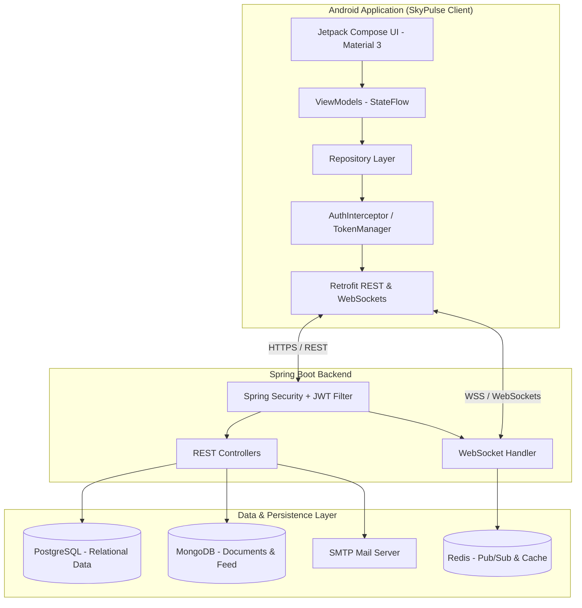

<div align="center">

# SkyPulse

**A Next-Generation Space, Weather, and Cosmic E-Commerce Experience on Android**

[](https://kotlinlang.org/)
[](https://developer.android.com/)
[](https://developer.android.com/jetpack/compose)
[](https://spring.io/projects/spring-boot)
[](LICENSE)

*SkyPulse seamlessly connects space enthusiasts, stargazers, and tech explorers by combining real-time weather and space atmospheric intelligence, an interactive social feed, live chat lounges, and an integrated cosmic marketplace in a high-performance Material 3 Jetpack Compose application.*

</div>

---

## Project Description

SkyPulse is a multi-domain Android application engineered for stargazers, amateur astronomers, space technology followers, and outdoor observers. The platform integrates real-time meteorological data and atmospheric viewing analysis with community-driven space exploration and specialized equipment commerce.

### The Problem It Solves
Stargazers and space technology followers typically navigate fragmented digital tools:
1. Standard weather applications lack specialized stargazing parameters such as sky clarity indices, light pollution considerations, and moon phase illumination percentages.
2. Astronomy news and updates from global space agencies (NASA, ISRO, ESA) are scattered across disparate social networks and web portals.
3. Communities discussing real-time satellite passes, rocket launches, or celestial phenomena rely on disconnected messaging boards.
4. Purchasing specialized optical hardware, astronomical accessories, and space merchandise requires browsing separate e-commerce platforms with no direct link to observational planning.

SkyPulse unifies these capabilities into a cohesive, high-performance tactical interface styled after modern Heads-Up Display (HUD) telemetry systems.

### Core Pillars
- **Atmospheric & Stargazing Intelligence:** Provides live local meteorological telemetry combined with sky condition evaluations to inform astronomers when atmospheric conditions are optimal for observation.
- **Curated Exploration Feed:** Aggregates verified mission updates, astronomical photography, and deep-space milestones into an interactive community feed.
- **Encrypted Comms Lounges:** Offers low-latency frequency-based communication channels (RF-01 through RF-06) for coordinated observations and live launch discussions.
- **Integrated Space Marketplace:** Provides a full-featured e-commerce catalog featuring optical gear, collectibles, and apparel, complete with dynamic discounts and a streamlined multi-tiered checkout flow.
- **Enterprise-Grade Infrastructure:** Backed by a polyglot persistence architecture utilizing Spring Boot 3, PostgreSQL, MongoDB, Redis, and WebSockets.

---

## Overview and Architecture Documentation

SkyPulse is built adhering to Modern Android Development (MAD) practices, utilizing a unidirectional data flow (UDF) pattern with Model-View-ViewModel (MVVM) architecture, Jetpack Compose for declarative UI rendering, and Kotlin Coroutines/StateFlow for asynchronous state management.

For in-depth architectural specifications and implementation justifications, refer to:
* [Android Frontend Architecture Documentation (FRONTEND.md)](FRONTEND.md)
* [Spring Boot Backend Architecture Documentation (BACKEND.md)](BACKEND.md)

---

## Key Features

### Weather and Atmospheric Intelligence (HomeScreen)
* **Real-Time Meteorological Telemetry:** Live monitoring of temperature, relative humidity, wind velocity, UV index, and extended atmospheric forecasts.
* **Adaptive Sky Gradients:** Dynamic background color transitions that adjust according to current weather conditions, time of day, and celestial illumination.
* **Global Location Search:** Instantaneous meteorological telemetry lookup for any city worldwide with automatic caching and error recovery.
* **Stargazing Conditions Evaluation:** Algorithmic calculation of sky visibility and viewing clarity to assist amateur astronomers before setting up optical equipment.

### Cosmic Social Feed (HomeFeedScreen)
* **Mission & Astronomy Aggregator:** Centralized feed showcasing planetary missions, astrophotography, and deep-space discoveries from space agencies (ISRO, NASA) and research groups.
* **Community Interactions:** Interactive engagement including post reactions, comments, bookmarking, and custom observation log submissions.
* **Optimized Media Loading:** Asynchronous image loading and multi-layer memory/disk caching powered by Coil.

### Cosmic Shop and E-Commerce (ShopScreen and CartBottomSheet)
* **Curated Equipment Catalog:** Direct access to telescopes, optical accessories, astrophotography components, and curated space apparel.
* **Dynamic Search and Filtering:** Search bar with cycling query suggestions, multi-attribute filter modals, and real-time category sorting.
* **Interactive Shopping Cart:** Slide-over cart bottom sheet supporting on-the-fly quantity adjustments, subtotal updates, and instant dismiss gestures.
* **Comprehensive Checkout Experience:** Dedicated CheckoutScreen featuring promotional coupon validation (NEWMON30, WINTERSOL, ORBITLAUNCH, ASTROCARD, YASHREF50), referral discounts, and breakdown of fees.
* **Order History Management:** Order status tracking and digital order manifest history linked to user accounts.

### Live Comms Channels (RoomsScreen)
* **HUD Telemetry Channels:** Dedicated group communication channels organized by frequency identifiers (RF-01 through RF-06).
* **Real-Time Messaging:** Instant messaging sync powered by bi-directional OkHttp WebSockets on Android and Spring WebSocket with Redis Pub/Sub on the backend.
* **Channel Access Controls:** Support for encrypted private channels secured with passkey verification and custom 3D avatar identifiers.

### Profile and Identity Management (LoginScreen and ProfileScreen)
* **Slate Onyx Profile Interface:** Visual identity dashboard featuring landscape backdrops, clearance levels, telemetry impact metrics, active equipment rosters, and an unlocked achievements bento grid.
* **Stateless JWT Authentication:** Secure login and registration backed by Spring Security, BCrypt password hashing, and hardware-backed encrypted token persistence via Android KeyStore (TokenManager).

---

## Technology Stack Overview

Detailed technology breakdowns and one-line architectural justifications are available in [FRONTEND.md](FRONTEND.md) and [BACKEND.md](BACKEND.md).

### Android Frontend (See [FRONTEND.md](FRONTEND.md))
| Component | Technology / Library | Architectural Justification |
| :--- | :--- | :--- |
| **Language** | Kotlin 2.4+ | Native null safety, extension functions, and first-class Coroutines support eliminate boilerplate and NullPointerExceptions compared to Java. |
| **UI Framework** | Jetpack Compose (Material 3) | Unidirectional data flow and reactive state-driven rendering eliminate layout inflation overhead compared to traditional XML views. |
| **Architecture** | MVVM + StateFlow | Cold stream execution, native Coroutine operators, and lifecycle-independent state flow provide predictable reactive state propagation. |
| **Networking** | Retrofit 3.0 & OkHttp 4 | Type-safe annotation-driven HTTP interface definition with custom interceptor middleware for automated JWT injection. |
| **WebSockets** | OkHttp WebSockets | Low-latency bi-directional socket communication with minimal bandwidth and processing overhead compared to HTTP long-polling. |
| **Image Loading** | Coil Compose | Native integration with Jetpack Compose and Coroutines with lightweight memory footprints compared to Glide or Picasso. |
| **Security** | Encrypted TokenManager | Hardware-backed AES-256 encryption via Android KeyStore protects user session tokens from extraction on compromised devices. |

### Backend Infrastructure (See [BACKEND.md](BACKEND.md))
| Layer | Technology | Architectural Justification |
| :--- | :--- | :--- |
| **Framework** | Java 17/21 / Spring Boot 3 | Enterprise dependency injection, high-throughput multi-threading, and extensive ecosystem support for concurrent client connections. |
| **Security** | Spring Security + JWT | Stateless token authentication enables horizontal scaling across distributed instances without session replication requirements. |
| **Relational Database** | PostgreSQL & Spring Data JPA | ACID-compliant transaction integrity, relational schema support, and JSONB indexing for users, orders, and product catalogs. |
| **Document Database** | MongoDB | Dynamic schema-less storage optimized for rapid writes and flexible structures for social feeds and historical chat logs. |
| **In-Memory Cache & Broker** | Redis & Redis Pub/Sub | Sub-millisecond latency for catalog caching and high-throughput real-time message routing across WebSocket subscribers. |
| **Real-time Protocol** | WebSockets (STOMP) | Full bi-directional client-server messaging allowing simultaneous transmission and reception over a single persistent TCP connection. |
| **Mail Services** | JavaMailSender (SMTP) | Automated transactional notifications for order manifests and security verifications without external vendor lock-in. |

---

## System Architecture



---

## Project Structure

```
SkyPulse/
|-- FRONTEND.md                                   # Detailed Android Frontend Tech Specs
|-- BACKEND.md                                    # Detailed Spring Boot Backend Tech Specs
|-- README.md                                     # Main Project Overview and Documentation
|-- app/
|   |-- build.gradle.kts
|   `-- src/
|       |-- main/
|       |   |-- AndroidManifest.xml
|       |   `-- java/com/yash/skypulse/
|       |       |-- MainActivity.kt               # App Entry Point & Navigation
|       |       |-- MainScreen.kt                 # Bottom Navigation Container
|       |       |-- HomeScreen.kt                 # Weather & Atmospheric Dashboard
|       |       |-- HomeFeedScreen.kt             # Social Space Feed Screen
|       |       |-- ShopScreen.kt                 # E-Commerce Catalog Screen
|       |       |-- CartBottomSheet.kt            # Cart Slide-Over Sheet
|       |       |-- CheckoutScreen.kt             # Full Checkout & Coupon Offers
|       |       |-- RoomsScreen.kt                # HUD Telemetry Comms Channels
|       |       |-- ProfileScreen.kt              # Slate Onyx Profile Variant
|       |       |-- LoginScreen.kt                # Auth Screen (Login & Register)
|       |       |-- WeatherApi.kt                 # Retrofit Interface for Weather Data
|       |       |-- SkyPulseApi.kt                # Retrofit Interface for Spring Backend
|       |       |-- TokenManager.kt               # Encrypted JWT Token Persistence
|       |       |-- AuthInterceptor.kt            # OkHttp JWT Header Interceptor
|       |       `-- ui/theme/                     # Material 3 Color Palette, Type & Theme
|       `-- res/                                  # Drawables, Mipmaps, Values & XML
|-- gradle/
|   `-- libs.versions.toml                        # Version Catalog Dependencies
|-- build.gradle.kts
`-- settings.gradle.kts
```

---

## Getting Started

### Prerequisites
* **Android Studio:** Android Studio Ladybug (2024.2.1) or newer recommended.
* **JDK:** Java 11 or higher (Java 17/21 recommended).
* **Android SDK:** Target SDK 37, Minimum SDK 24 (Android 7.0+).

### Installation and Setup

1. **Clone the Repository:**
   ```bash
   git clone https://github.com/yashdev404/SkyPulse-Android.git
   cd SkyPulse-Android
   ```

2. **Configure API Keys:**
   SkyPulse utilizes a weather data provider for live meteorological telemetry. Add your API key to local.properties in the project root:
   ```properties
   WEATHER_API_KEY=your_weather_api_key_here
   ```

3. **Build and Run:**
   * Open the project in Android Studio.
   * Allow Gradle to sync dependencies.
   * Select an Android Virtual Device (AVD) or connected physical device and execute **Run** (`Shift + F10`).

---

## License

This project is licensed under the MIT License - see the [LICENSE](LICENSE) file for details.

<div align="center">
  <sub>Built using Kotlin and Jetpack Compose</sub>
</div>
