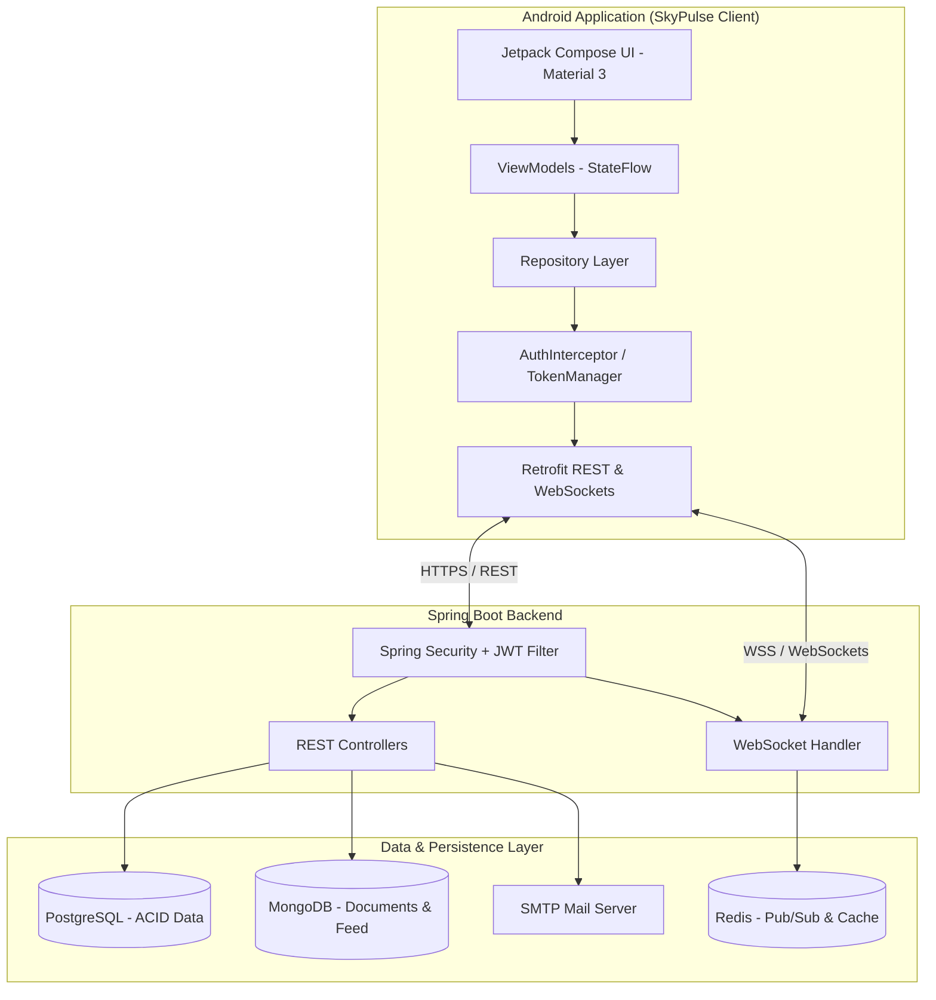

<div align="center">

# 🌌 SkyPulse

**A Next-Generation Space, Weather, and Cosmic E-Commerce Experience on Android**

[](https://kotlinlang.org/)
[](https://developer.android.com/)
[](https://developer.android.com/jetpack/compose)
[](https://spring.io/projects/spring-boot)
[](LICENSE)

*SkyPulse seamlessly connects space enthusiasts, stargazers, and tech explorers by combining real-time weather & space atmospheric intelligence, an interactive social feed, live chat lounges, and an integrated cosmic marketplace—all in a high-performance Material 3 Jetpack Compose application.*

</div>

---

## 📖 Overview

**SkyPulse** evolved from a hyper-focused atmospheric weather utility into a feature-rich, multi-domain Android ecosystem. Built with modern Android development standards, SkyPulse features a reactive, state-driven UI powered by **Jetpack Compose (Material 3)**, asynchronous data streams with **Kotlin Coroutines & Flow**, and a polyglot persistence **Spring Boot** backend.

Whether checking local weather conditions, exploring space news, discussing astronomical discoveries in real-time lounges, or purchasing stargazing equipment, SkyPulse provides an intuitive and visual-first experience.

---

## ⚡ Key Features

### 🌤️ Weather & Atmospheric Intelligence (`HomeScreen`)
* **Real-time Meteorological Data:** Live temperature, humidity, wind conditions, UV index, and weather forecasts.
* **Dynamic Sky Gradients:** Ambient background gradients and UI themes that adapt smoothly to current weather conditions (e.g., Clear Sky, Rain, Thunderstorms, Night/Space).
* **Location Search:** Global city search with instant meteorological data fetching.

### 🚀 Cosmic Social Feed (`HomeFeedScreen`)
* **Space & Astronomy Aggregator:** Dynamic feed featuring space missions, astronomical photography, and tech discoveries from space agencies (ISRO, NASA) and space tech sources.
* **Interactive Community Engagement:** Express reactions (Likes, Comments, Bookmarks) and share content with fellow space enthusiasts.

### 🛍️ Cosmic Shop & E-Commerce (`ShopScreen` & `CartBottomSheet`)
* **Space Gear & Merchandise:** Curated catalog of telescopes, astrophotography gear, apparel, and space memorabilia.
* **Smart Shopping Cart:** Interactive slide-over cart bottom sheet supporting real-time quantity adjustments and total calculation.
* **Zomato / Amazon-Style Checkout:** Dedicated `CheckoutScreen` supporting custom promo codes, Zomato/Amazon style coupon cards (`NEWMON30`, `WINTERSOL`, `ORBITLAUNCH`, `ASTROCARD`, `YASHREF50`), referral discounts, and instant card offers.
* **Order History:** Track current and past order status linked to user accounts.

### 💬 Live Chat Lounges (`RoomsScreen`)
* **HUD Telemetry Comms Channels:** Real-time channels with frequency codes (`RF-01` to `RF-06`), radar search, encrypted private channels, and custom 3D avatar spheres.
* **Real-time Messaging:** Persistent message sync and instant chat feeds powered by WebSockets and Redis Pub/Sub.

### 👤 Profile & Authentication (`LoginScreen` & `ProfileScreen`)
* **Slate Onyx Profile Variant:** Hero header with moonlit landscape backdrop, clearance stats, HUD telemetry metrics, active equipment list, and unlocked badges grid.
* **JWT-Based Authentication:** Secure Login and Registration backed by Spring Security and `TokenManager`.

---

## 🛠️ Technology Stack

### **Android Frontend**
| Component | Technology / Library |
| :--- | :--- |
| **Language** | Kotlin 2.4+ |
| **UI Framework** | Jetpack Compose (Material 3) |
| **Architecture** | MVVM (Model-View-ViewModel) + Unidirectional Data Flow (UDF) |
| **Networking** | Retrofit 3.0, Gson Converter, OkHttp 4 |
| **Async & State** | Kotlin Coroutines & `StateFlow` / `SharedFlow` |
| **Image Loading** | Coil Compose |
| **Animations** | Lottie Compose |
| **Splash Screen** | AndroidX Core Splashscreen |

### **Backend Architecture**
| Layer | Technology |
| :--- | :--- |
| **Framework** | Java 17/21 / Spring Boot 3 |
| **Security** | Spring Security with Stateless JWT Authentication |
| **Relational DB** | PostgreSQL (Users, Products, Cart, Orders & Transactions) |
| **Document DB** | MongoDB (Feed Posts, Articles, Chat History) |
| **In-Memory Caching** | Redis (Pub/Sub for Chat Rooms, Session Caching) |
| **Real-time Protocol** | WebSockets (Spring WebSocket) |
| **Email Service** | JavaMailSender (Transactional Checkout Confirmations) |

---

## 🏗️ System Architecture



---

## 📁 Project Structure

```
SkyPulse/
├── app/
│   ├── build.gradle.kts
│   └── src/
│       ├── main/
│       │   ├── AndroidManifest.xml
│       │   └── java/com/yash/skypulse/
│       │       ├── MainActivity.kt               # App Entry Point & Navigation
│       │       ├── MainScreen.kt                 # Bottom Navigation Container
│       │       ├── HomeScreen.kt                 # Weather & Atmospheric Dashboard
│       │       ├── HomeFeedScreen.kt             # Social Space Feed Screen
│       │       ├── ShopScreen.kt                 # E-Commerce Catalog Screen
│       │       ├── CartBottomSheet.kt            # Cart Slide-Over Sheet
│       │       ├── CheckoutScreen.kt             # Full Checkout & Coupon Offers
│       │       ├── RoomsScreen.kt                # HUD Telemetry Comms Channels
│       │       ├── ProfileScreen.kt              # Slate Onyx Profile Variant
│       │       ├── LoginScreen.kt                # Auth Screen (Login & Register)
│       │       ├── WeatherApi.kt                 # Retrofit Interface for Weather Data
│       │       ├── SkyPulseApi.kt                # Retrofit Interface for Spring Backend
│       │       ├── TokenManager.kt               # Encrypted JWT Token Persistence
│       │       ├── AuthInterceptor.kt            # OkHttp JWT Header Interceptor
│       │       └── ui/theme/                     # Material 3 Color Palette, Type & Theme
│       └── res/                                  # Drawables, Mipmaps, Values & XML
├── gradle/
│   └── libs.versions.toml                        # Version Catalog Dependencies
├── build.gradle.kts
├── settings.gradle.kts
└── README.md
```

---

## 🚀 Getting Started

### **Prerequisites**
* **Android Studio:** Android Studio Ladybug (2024.2.1) or newer recommended.
* **JDK:** Java 11 or higher (Java 17 recommended).
* **Android SDK:** Target SDK `37`, Minimum SDK `24` (Android 7.0+).

### **Installation & Setup**

1. **Clone the Repository:**
   ```bash
   git clone https://github.com/yashdev404/SkyPulse-Android.git
   cd SkyPulse-Android
   ```

2. **Configure API Keys:**
   SkyPulse utilizes a Weather API for live meteorological data. Add your API Key to `local.properties` in the project root:
   ```properties
   WEATHER_API_KEY=your_weather_api_key_here
   ```

3. **Build & Run:**
   * Open the project in Android Studio.
   * Allow Gradle to sync dependencies.
   * Select an Android Emulator or physical device and press **Run** (`Shift + F10`).

---

## 🌐 Backend & API Endpoint Reference

The Android client connects to the Spring Boot REST services via `SkyPulseApi`:

| Method | Endpoint | Description | Auth Required |
| :--- | :--- | :--- | :---: |
| `POST` | `/api/v1/auth/login` | Authenticate user & return JWT token | ❌ |
| `POST` | `/api/v1/auth/register` | Register a new user account | ❌ |
| `GET` | `/api/v1/feed` | Fetch community feed posts | ❌ |
| `GET` | `/api/v1/shop/products` | Fetch space products catalog | ❌ |
| `POST` | `/api/v1/shop/checkout` | Process shopping cart checkout | ✅ |
| `GET` | `/api/v1/shop/orders/{username}` | Fetch user order history | ✅ |
| `GET` | `/api/v1/rooms/{roomId}/messages` | Retrieve persistent chat room messages | ✅ |

---

## 🤝 Contributing

Contributions are always welcome!
1. Fork the Project
2. Create your Feature Branch (`git checkout -b feature/AmazingFeature`)
3. Commit your Changes (`git commit -m 'Add some AmazingFeature'`)
4. Push to the Branch (`git push origin feature/AmazingFeature`)
5. Open a Pull Request

---

## 📜 License

This project is licensed under the MIT License.

<div align="center">
  <sub>Built with ❤️ using Kotlin & Jetpack Compose</sub>
</div>
